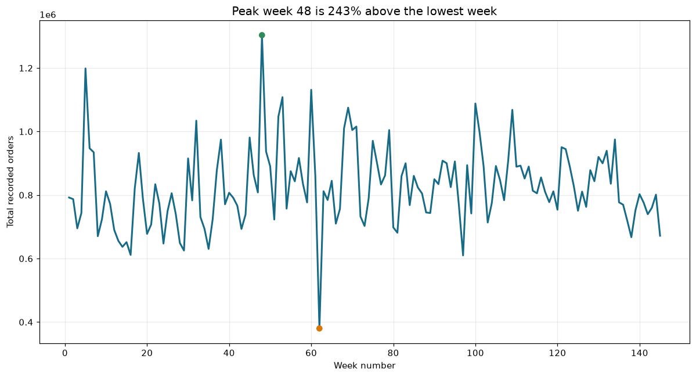
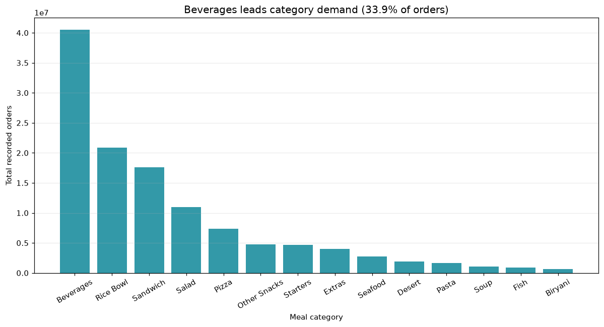
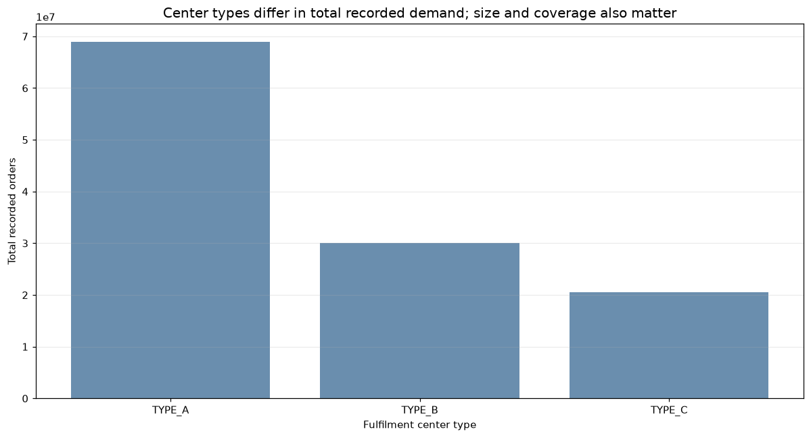
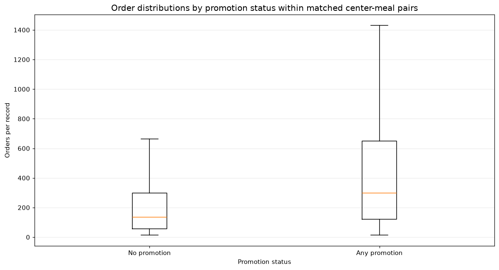
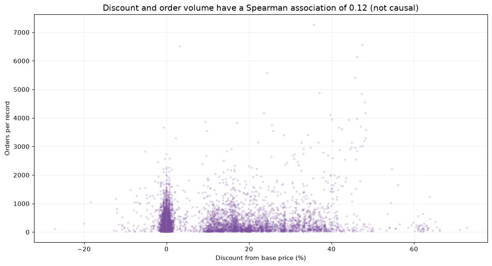
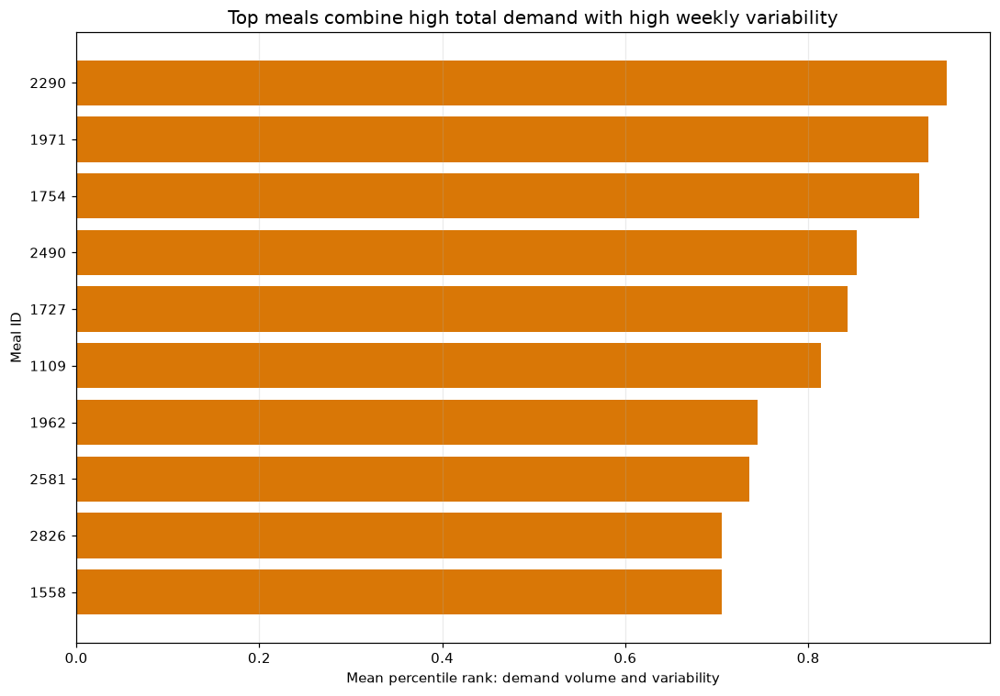

# تقرير أداء الطلب | Food Delivery Demand Review

**الفترة:** الأسابيع 1–145  
**الجمهور:** فريق العمليات والتسويق  
**المصدر:** ملفات التدريب ومعلومات الوجبات والمراكز المرفقة؛ أعيد إنتاج الأرقام في [دفتر التحليل](../notebooks/analysis.ipynb).

## الملخص التنفيذي

### النتائج المرصودة

- سُجل **119,557,485 طلبًا** خلال **145 أسبوعًا**، بمتوسط **824,534 طلبًا أسبوعيًا**. تراوح الطلب الأسبوعي بين **380,065** في الأسبوع 62 و**1,303,457** في الأسبوع 48.
- تصدرت فئة المشروبات بحصة **33.9%** من الطلب المسجل. وكانت الوجبة **2290** الأعلى مجموعًا بنحو **9.77 مليون طلب**؛ وبلغت أول **22 وجبة من أصل 51** نحو 80% من الطلب.
- سجّل المركز **13 (TYPE_B)** أعلى مجموع طلب، بنحو **4.30 مليون**. لا يكفي المجموع وحده للحكم على الكفاءة، لاختلاف أحجام المراكز والتغطية.
- ضمن أزواج المركز والوجبة التي ظهرت في حالتي الترويج وعدم الترويج، كان وسيط الطلب **338 مع البريد مقابل 149 من دونه**، و**350 مع الصفحة الرئيسية مقابل 148 من دونها**. هذه فروق مرصودة ولا تثبت أن الترويج سبب زيادة الطلب.
- بلغ ارتباط Spearman بين الخصم والطلب **0.122**؛ وهو ارتباط موجب ضعيف. وظهرت الوجبة **2290** ضمن أعلى أولويات مراجعة الحجم والتذبذب، بمعامل تذبذب يقارب **0.90**.

### ماذا تعني النتائج؟

توضح البيانات أين تركز الطلب المسجل وكيف يختلف بين الأسابيع والفئات والمراكز. لكنها لا تقيس مباشرةً الطلب الذي لم يُلبَّ بسبب نفاد المخزون، ولا الهدر أو الربحية. وقد تتزامن العروض والخصومات مع اختلافات أخرى في الوجبة أو الأسبوع؛ لذلك لا تثبت المقارنات الرصدية السببية.

### التوصيات ومقاييس النجاح

1. **اختبار مخزون تجريبي حسب المركز والوجبة:** استخدم مئين الطلب 90 مرجعًا للمراجعة، وقِس النفاد والهدر لكل 1,000 طلب مع الحفاظ على مستوى الخدمة.
2. **اختبار مضبوط للبريد والصفحة الرئيسية:** افصل القنوات وحدد مجموعة مقارنة، ثم قِس الطلب والهامش الإضافي بعد تكلفة الحملة، مع مراقبة النفاد والإلغاءات.
3. **اختبار درجات خصم محددة:** قِس هامش المساهمة بعد تكلفة المواد والترويج والهدر، لا حجم الطلب وحده.

### حدود القراءة

الأسابيع أرقام وليست تواريخ فعلية، والمواقع مجهولة الهوية. لا تتوفر بيانات المخزون أو النفاد أو الهدر أو تكاليف المواد. لذلك لا تفسر الارتباطات على أنها أسباب، ولا تعتبر غياب سجل أسبوعي طلبًا صفريًا. الأرقام والرسوم أعلاه قابلة لإعادة الإنتاج من [دفتر التحليل](../notebooks/analysis.ipynb)، والتفاصيل المنهجية والرسوم موضحة في أقسام التقرير التالية.

## إجابات أسئلة العمل

### 1. كيف يتغير الطلب من أسبوع إلى آخر؟

تراوح الإجمالي الأسبوعي بين **380,065** طلبًا في الأسبوع 62 و**1,303,457** في الأسبوع 48؛ أي إن الأسبوع الأعلى سجّل نحو **243%** أكثر من الأدنى. توجد تقلبات ملحوظة، لكن رقم الأسبوع لا يقابل تاريخًا تقويميًا، ولا تثبت القمم وحدها وجود موسمية.

### 2. ما الفئات والوجبات الأعلى طلبًا؟

تصدّرت المشروبات بحصة **33.9%** من مجموع الطلب. كانت الوجبة **2290** الأعلى، بنحو **9.77 مليون طلب**. تجاوزت أول **22 وجبة** معًا 80% من الطلب المسجل؛ ما يدعم مراجعة تغطية هذه المجموعة كأولوية تخطيط، لا إهمال بقية القائمة.

### 3. أي المراكز أعلى أداءً؟ وهل يختلف الأداء بحسب النوع؟

كان المركز **13 (TYPE_B)** الأعلى في مجموع الطلب المسجل، بنحو **4.30 مليون**. سجّلت مراكز TYPE_A مجتمعة نحو **68.98 مليون**، وTYPE_B نحو **30.00 مليون**، وTYPE_C نحو **20.58 مليون**. ولأن الأنواع تختلف في عدد المراكز والتغطية، لا يساوي الإجمالي وحده الكفاءة؛ متوسط الطلب لكل سجل كان نحو **262** في TYPE_A، و**319** في TYPE_B، و**207** في TYPE_C.

### 4. هل يرتبط الترويج بارتفاع الطلب؟

قُورنت السجلات مع الترويج وبدونه داخل أزواج **المركز × الوجبة** التي ظهرت في الشرطين. كان وسيط الطلب مع البريد **338** مقابل **149** من دونه (**+126.8%**)، ومع الظهور على الصفحة الرئيسية **350** مقابل **148** (**+136.5%**). أظهرت اختبارات Mann–Whitney فروقًا إحصائية مع قيم Holm المعدّلة أقل من \(10^{-300}\) (ضمن الدقة العددية).

هذه فروق ارتباطية كبيرة في عينة واسعة، وليست تقديرًا سببيًا: قد تُوجّه الحملات أصلًا إلى وجبات أو أسابيع ذات طلب مختلف، وقد تتزامن مع خصم أو عوامل أخرى. لا ينبغي اعتبار قيمة p دليلًا على الربحية أو جدوى الإنفاق.

### 5. ما علاقة الخصم بالطلب؟

ارتباط Spearman بين نسبة الخصم والطلبات **0.122**، موجب لكنه ضعيف؛ قيمة p صغيرة جدًا بسبب حجم العينة. قد تترافق الخصومات مع ترويج أو اختيار منتجات وأسابيع مختلفة. لا تستخدم النتيجة للتنبؤ بأثر رفع الخصم دون تجربة وقياس هامش المساهمة.

### 6. ما الوجبات التي تستحق مراجعة احتياطي المخزون؟

تجمع الوجبة **2290** أعلى حجم طلب مع تذبذب أسبوعي نسبي يقارب **0.90**، ثم تأتي وجبتا الساندويتش **1971** (معامل تذبذب **1.10**) و**1754** (نحو **0.89**). هذه أولوية فرز على مستوى الوجبة، وليست توصية شراء موحدة؛ يجب الرجوع إلى جداول المركز-الوجبة، والطلب المئيني 90، والتغطية المتاحة قبل تحديد الكميات.

## التوصيات ومقاييس النجاح

| القرار | الدليل | طريقة التنفيذ | مؤشر النجاح |
|---|---|---|---|
| بدء تجربة مخزون للوجبات الأعلى طلبًا وتذبذبًا حسب كل مركز | الوجبة 2290: 9.77 مليون طلب ومعامل تذبذب 0.90؛ والوجبتان 1971 و1754 أيضًا مرتفعتا الحجم والتذبذب | استخدم سجل المركز-الوجبة والمئين 90 مرجعًا مبدئيًا، ثم نفّذ تجربة تجريبية مع مجموعة مقارنة وقيّد إعادة الطلب بتوفر التخزين والصلاحية | انخفاض نسبة نفاد المخزون والهدر لكل 1,000 طلب، دون تراجع مستوى الخدمة |
| اختبار البريد والصفحة باختبار عشوائي أو إطلاق متدرج | فرق الوسيط المرصود +126.8% للبريد و+136.5% للصفحة ضمن أزواج متطابقة، دون دليل سببي | عيّن وحدات الاختبار مسبقًا، وافصل القنوات، وسجّل خصومات/عوامل التداخل | الزيادة في الطلب والهامش الإضافي بعد تكلفة الحملة، مع مراقبة النفاد والإلغاءات |
| تقييم الخصم بهامش المساهمة لا بالحجم وحده | ارتباط Spearman ضعيف موجب 0.122؛ لا تتوفر كلفة المواد أو هامش الربح في البيانات | اختبر درجات خصم مضبوطة على وجبات/مراكز محددة مع مجموعة ضبط | هامش المساهمة الإضافي لكل حملة، مع تكلفة المواد والترويج والهدر |

## جودة البيانات والتنظيف

تضم ملفات التدريب والاختبار **456,548** و**32,573** صفًا على التوالي. لا توجد قيم مفقودة أو تكرارات لمفتاح الأسبوع/المركز/الوجبة، ولم تتغير صفوف التدريب أو قيمة الطلب الإجمالي (**119,557,485**) بعد الإثراء بجداول المراكز والوجبات. لم تُسجل أسابيع عامة مفقودة، لكن **2,350** سلسلة مركز-وجبة لا تغطي كل أسابيع التدريب.

سُجل سعر بيع أعلى من السعر الأساسي في **116,101** صف، وطلبات تتجاوز حد IQR الأعلى في **32,937** صفًا؛ احتُفظ بها دون تصحيح لأنها ليست أخطاء مؤكدة. قرارات الفحص كاملة في [cleaning_decisions.csv](../docs/cleaning_decisions.csv). ملفات المصدر لم تُعدّل.

## الحدود

- الأسابيع أرقام ترتيبية وليست تواريخ فعلية؛ أكواد المدن والمناطق مجهولة الهوية.
- لا توجد بيانات مباشرة عن الكميات المطلوبة من الموردين، المخزون، النفاد، التلف، الإلغاءات، تكاليف المواد أو هامش الربح.
- الطلب المرصود قد يكون مقيدًا بتوفر الوجبة؛ غياب صف لا يثبت أن الطلب صفر.
- العروض والخصومات لم توزع عشوائيًا؛ لا يمكن إثبات السببية من المقارنات والارتباطات الوصفية.
- الاختبار الإحصائي قد يكتشف فرقًا صغيرًا عند عينة كبيرة؛ لذلك يُعرض حجم الفرق بجانب قيمة p.
- لا يحتوي `test.csv` على `num_orders`، فلا يمكن تقييم مخرجات تنبؤ عليه قبل توفر القيم الحقيقية.

## إضافة اختيارية: التنبؤ

قورِن انحدار خطي بسيط بخط أساس الطلب في الأسبوع السابق على تحقق زمني للأسابيع **136–145**، باستخدام السجلات التي لها أسبوع سابق متصل. بلغ **MAE الانحدار الخطي 97.16** طلبًا لكل سجل، مقابل **81.78** لخط الأساس؛ لذلك اختير خط الأساس للتنبؤات الأولية بدل اختيار نموذج أعقد لمجرد كونه تعلمًا آليًا. تتضمن [ملف التنبؤات](test_predictions.csv) تنبؤ الانحدار والخط الأساسي والنموذج المختار لكل صف في الاختبار.

هذا تحقق خطوة واحدة إلى الأمام، وليس محاكاة مستقلة كاملة لأفق العشرة أسابيع؛ كما أن نجاح التنبؤات المستقبلية لا يُعرف قبل وصول `num_orders` الفعلي. يلزم إعادة تقييم زمني دوري قبل استخدام المخرجات للشراء.
